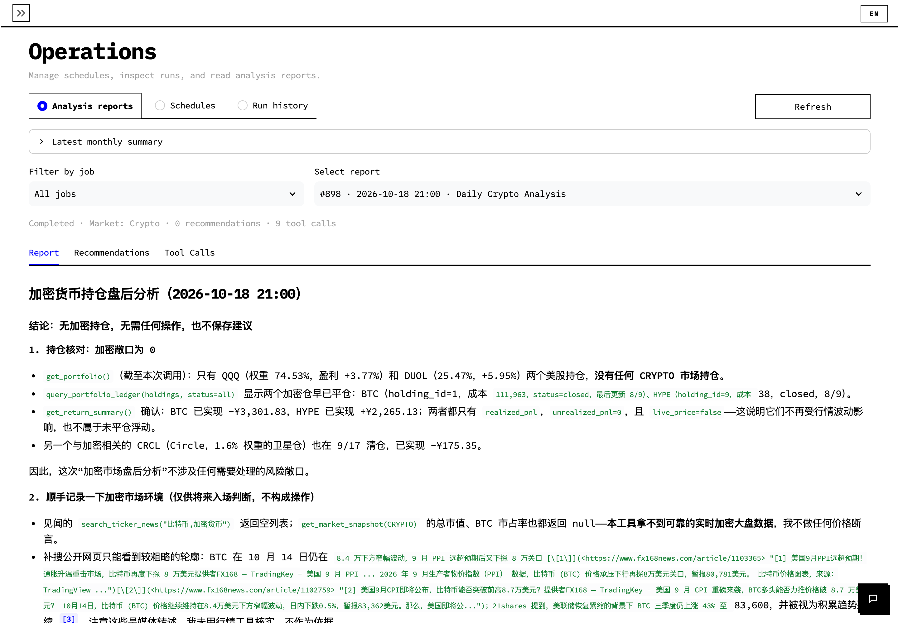
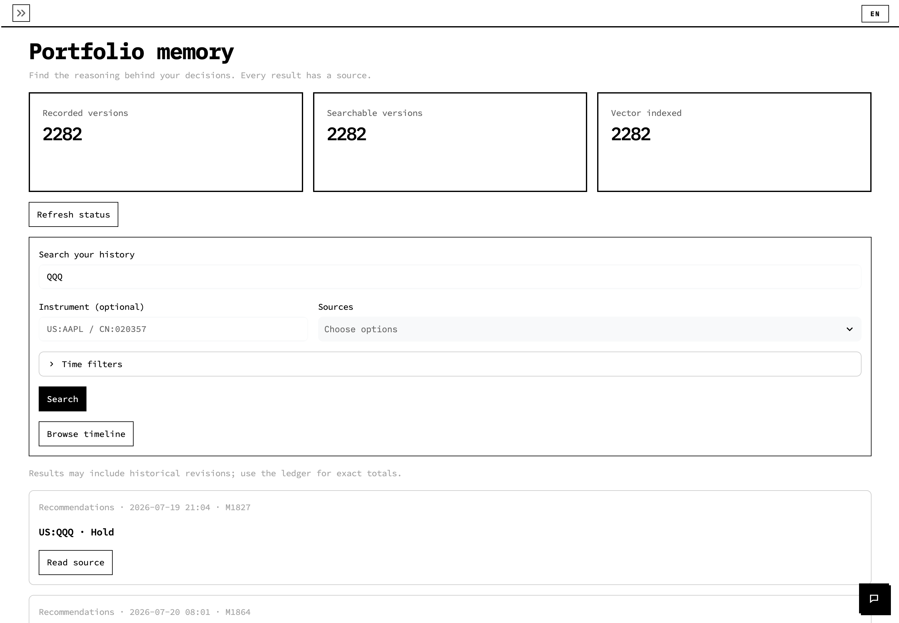
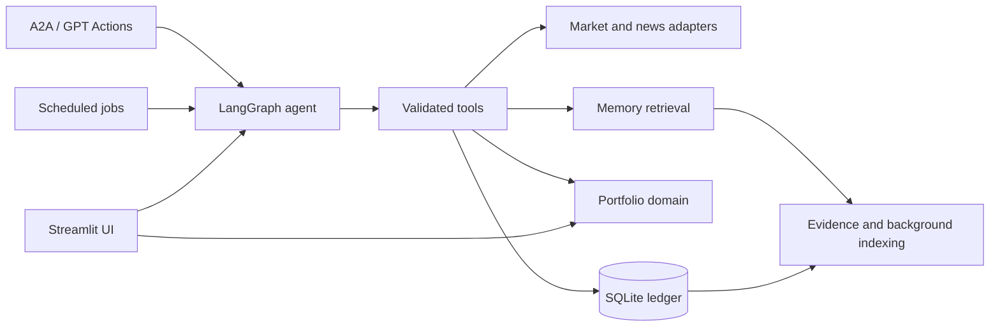

# Portfolio Agent

[中文](README_CN.md) · [Architecture](docs/architecture.md) · [Development](CONTRIBUTING.md)

An AI-assisted portfolio research and decision-tracking system for **US equities, China A-shares and funds, Hong Kong equities, and crypto**. It connects a real portfolio ledger to market data, a bounded LangGraph agent, scheduled analysis and source-linked investment memory.

The deployed application requires an authorized Google account. It supports research and manual decision tracking; it does not place broker orders.

## Product walkthrough

### Portfolio dashboard

CNY-normalized portfolio value, realized and unrealized return, trading discipline, and core/satellite positions. Quote prices retain their native currencies.


### Analysis and operations

Read saved reports with source citations, inspect recommendations and tool calls, or switch to schedules and run history. Six scheduled jobs cover venue-specific market closes, news monitoring and monthly reviews.



### Investment memory

Retrieve historical decisions, conversations, transactions and reports with source IDs and time filters. SQLite FTS5 works locally; optional Qdrant and an embedding API add semantic retrieval.



<details>
<summary>More product views</summary>

**Holdings:** position management, weighted-average buys, residual-cost sells and the transaction ledger.


**Ask Agent:** global multi-turn chat with streaming responses; conversations appear in the analysis workspace.


</details>

## Engineering highlights

| Concern | Implementation |
| --- | --- |
| Shared business logic | UI-independent portfolio calculations in `domain/`; both UI and agent use the same accounting rules |
| Bounded agent execution | Overall and per-tool deadlines, duplicate-call limits, round budgets, read-only external tool access |
| Traceability | Persisted sessions, tool arguments/results, numbered source citations, recommendation decisions and immutable evidence versions |
| Resilience | Persisted quote snapshots, background refresh deadlines, last-known FX fallback and explicit degraded-provider responses |
| Memory consistency | Evidence capture in the business transaction; background indexing with bounded batches, retries and embedding reuse |
| Service lifecycle | One process-level bootstrap shared by entry points; concurrent-start protection, failure cleanup and explicit shutdown |
| Verification | Ruff lint/format, pytest behavior and UI tests, architecture import rules, GitHub Actions on Python 3.11/3.13 |

See [architecture and tradeoffs](docs/architecture.md) for dependency boundaries and limitations.

## Architecture



```text
portfolio-agent/
├── domain/       # Pure portfolio valuation and market conventions
├── adapters/     # Market, news, web search and FX providers
├── agent/        # Graph, tool contracts, execution guards and sessions
├── app/          # Google auth, renderable views, UI components and i18n
├── db/           # Models, repositories and migrations
├── memory/       # Evidence capture, indexing and hybrid retrieval
├── scheduler/    # Recurring jobs and manual triggers
├── a2a/          # A2A and GPT Actions read-only interfaces
├── notifier/     # Optional send-only Telegram delivery
├── common/       # Shared time handling
├── runtime.py    # Process initialization and resource ownership
├── server.py     # Production entry point
├── tests/        # Isolated regression and architecture tests
└── deploy/       # systemd, HTTPS and integration setup
```

## Quick start

Python **3.11+** is the development baseline. The UI uses Streamlit, the agent uses LangGraph/LangChain and DeepSeek's OpenAI-compatible API, and persistence uses SQLAlchemy 2.0 with SQLite.

```bash
python3 -m venv .venv
.venv/bin/python -m pip install -r requirements.txt
cp .env.example .env
# Set DEEPSEEK_API_KEY in .env.
# For local-only development without Google OIDC: AUTH_ENABLED=false
./run.sh
```

Open [localhost:8501](http://localhost:8501). `run.sh` prefers the project virtual environment. For public access, keep `AUTH_ENABLED=true`, configure Google OIDC and an exact email allowlist using the [login guide](docs/google-login.md).

1. Add positions in **Holdings**; record later fills with **Buy / Sell**.
2. Use **Watchlist** to record pre-entry ideas and target ranges.
3. Review portfolio totals in **Dashboard**, or ask questions with **Ask Agent**.
4. Read **Operations → Analysis reports**; inspect **Schedules** and **Run history** for execution details.
5. Accept or dismiss suggestions in **Recommendations**. **History** retains the decisions; **Memory** retrieves their evidence.

## Configuration

The complete template is [.env.example](.env.example).

| Variable | Purpose / default |
| --- | --- |
| `DEEPSEEK_API_KEY` | Required agent API key |
| `DEEPSEEK_BASE_URL`, `DEEPSEEK_MODEL` | API endpoint and model; defaults are defined in `config.py` |
| `APP_TIMEZONE` | Display and scheduling timezone; `Asia/Shanghai` |
| `DATABASE_URL` | Optional SQLAlchemy URL; defaults to the repository's SQLite ledger |
| `AUTH_ENABLED`, `AUTH_ALLOWED_EMAILS` | Authentication enabled by default; empty allowlist denies all access |
| `NEWS_CRONTAB` | News schedule; `0 8-22/2 * * *`, editable in Operations |
| `BRAVE_SEARCH_API_KEY` | Optional web search when news retrieval has no relevant result |
| `TELEGRAM_BOT_TOKEN`, `TELEGRAM_CHAT_ID` | Optional send-only notifications |
| `MEMORY_VECTOR_ENABLED` | Optional semantic retrieval; disabled by default |
| `A2A_ENABLED`, `ACTIONS_ENABLED` | Optional external interfaces, each requiring its configured token |

Google client/cookie secrets belong in `.streamlit/secrets.toml`. API keys, that file and local databases are excluded from Git.

## Development and checks

```bash
.venv/bin/python -m pip install -r requirements-dev.txt
make check       # Lint, formatting and tests
make coverage    # Test coverage report
```

The default suite ignores local `.env` credentials and uses a temporary database. Real Qdrant integration is opt-in. Dependency versions use ranges; the repository does not yet provide a complete transitive lockfile. See [CONTRIBUTING.md](CONTRIBUTING.md).

## Deployment and integrations

```bash
sudo git clone https://github.com/YOUR_ACCOUNT/portfolio-agent.git /opt/portfolio-agent
cd /opt/portfolio-agent
sudo ./deploy/setup-server.sh
sudo nano /opt/portfolio-agent/.env
.venv/bin/python deploy/configure-google-auth.py --base-url https://portfolio.example.com
sudo systemctl restart portfolio-agent
```

Production starts through `server.py`, initializing configured services before a browser connects. The standalone API entry point is `python -m a2a.serve`. See the guides below for OAuth, HTTPS, tokens and service configuration.

- [Google login and HTTPS](docs/google-login.md)
- [A2A, MCP bridge and ChatGPT GPT Actions](docs/agent-interfaces.md)
- [Investment memory and Qdrant](docs/memory.md)
- [K-line volume and annotated reports](docs/kline-analysis.md)
- [Original design](docs/superpowers/specs/2026-07-18-portfolio-agent-design.md)

## Scope and limitations

This is a personal, single-process system. Multiple replicas need coordinated scheduling and shared locking. Data providers may return delayed or unavailable quotes; cached values and cost-basis fallbacks are not live-price guarantees. Tests verify software behavior, not investment returns or model accuracy.
