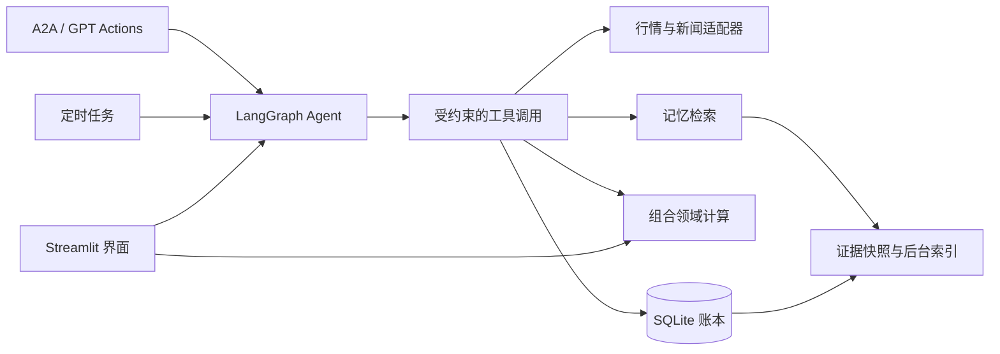

# Portfolio Agent｜投资组合助手

[English](README.md) · [架构设计](docs/architecture.md) · [开发规范](CONTRIBUTING.md)

面向 **美股、A 股与基金、港股、加密资产** 的个人投资研究与决策追踪系统。将真实持仓账本、行情数据、具备执行边界的 LangGraph Agent、定时分析和可追溯投资记忆连接起来，形成从研究到反馈的完整流程。

线上应用需要授权 Google 账号登录。系统辅助研究和人工决策记录，不连接券商自动下单。

## 产品演示

### 组合仪表盘

人民币口径总市值、已实现与未实现收益、交易纪律和核心／卫星持仓。成本与现价保留原币种，组合市值统一折算。


### 分析报告与运行中心

查看带来源引用的完整报告、建议与工具调用；切换任务调度和运行记录。六个定时任务覆盖各市场盘后分析、新闻监测和月度复盘。


### 投资记忆库

检索历史决策、对话、交易和报告，通过来源编号与时间条件追溯依据。SQLite FTS5 全文搜索开箱即用，按需接入 Qdrant 与 Embedding API 增加语义检索。


<details>
<summary>更多产品界面</summary>

**持仓管理：** 新增、编辑、买卖与完整成交流水；买入采用加权成本，卖出保留券商残馀成本口径。


**Ask Agent：** 全局浮动多轮对话，支持流式输出，对话报告可在运行中心查看。


</details>

## 工程设计亮点

| 关注点 | 实现方式 |
| --- | --- |
| 业务逻辑复用 | 收益核算放入独立 `domain/`，UI 与 Agent 共用同一套计算规则 |
| Agent 执行边界 | 总超时、单工具超时、重复调用限制、轮次预算，以及外部接口的只读工具白名单 |
| 可追溯性 | 会话、工具参数与结果、来源引用、建议处理记录和不可变证据版本 |
| 数据源容错 | 持久化行情快照、限时后台刷新、最后可用汇率兜底和显式降级结果 |
| 记忆一致性 | 业务写入与证据快照同事务提交，后台分批索引、失败重试与嵌入缓存 |
| 服务生命周期 | 各入口共享进程级初始化，并发启动保护、启动失败清理与显式关闭 |
| 质量检查 | Ruff 检查与格式化、pytest 行为和 UI 测试、架构依赖约束、Python 3.11/3.13 CI 配置 |

[架构与取舍](docs/architecture.md) 说明模块边界和当前限制。

## 架构



```text
portfolio-agent/
├── domain/       # 纯收益计算与市场币种约定
├── adapters/     # 行情、新闻、网页搜索和汇率适配器
├── agent/        # 状态图、工具契约、执行约束与会话
├── app/          # Google 认证、页面渲染、UI 组件和多语言
├── db/           # 数据模型、仓储操作与迁移
├── memory/       # 证据捕获、后台索引与混合检索
├── scheduler/    # 定时任务与手动触发
├── a2a/          # A2A 与 GPT Actions 只读接口
├── notifier/     # 可选 Telegram 单向推送
├── common/       # 共用时间处理
├── runtime.py    # 进程初始化与资源管理
├── server.py     # 生产启动入口
├── tests/        # 隔离的回归测试与架构检查
└── deploy/       # systemd、HTTPS 与集成部署
```

## 本地启动

开发基线为 Python **3.11+**。界面采用 Streamlit；Agent 使用 LangGraph / LangChain 与 DeepSeek 的 OpenAI 兼容接口；数据存储采用 SQLAlchemy 2.0 和 SQLite。

```bash
python3 -m venv .venv
.venv/bin/python -m pip install -r requirements.txt
cp .env.example .env
# 在 .env 配置 DEEPSEEK_API_KEY
# 仅本机开发、不配置 Google OIDC 时，可设置 AUTH_ENABLED=false
./run.sh
```

打开 [localhost:8501](http://localhost:8501)。启动脚本优先使用项目虚拟环境。公网部署保持 `AUTH_ENABLED=true`，按 [Google 登录指南](docs/google-login.md) 配置 OIDC 和精确邮箱白名单。

1. 在 **持仓** 添加仓位；后续成交通过 **买入／卖出** 记账。
2. 在 **监察表** 记录尚未建仓的标的、理由与目标区间。
3. 在 **仪表盘** 查看组合，或通过 **Ask Agent** 提问。
4. 在 **运行中心 → 分析报告** 查看结论，在 **任务调度／运行记录** 查看执行情况。
5. 在 **建议** 接受或忽略建议；**历史** 保存处理结果，**记忆库** 检索历史依据。

## 配置

完整配置模板见 [.env.example](.env.example)。

| 变量 | 用途／默认行为 |
| --- | --- |
| `DEEPSEEK_API_KEY` | 必填的 Agent API 密钥 |
| `DEEPSEEK_BASE_URL`、`DEEPSEEK_MODEL` | 接口地址与模型，默认值以 `config.py` 为准 |
| `APP_TIMEZONE` | 展示和调度时区，默认 `Asia/Shanghai` |
| `DATABASE_URL` | 可选 SQLAlchemy 地址，默认使用仓库内的 SQLite 账本 |
| `AUTH_ENABLED`、`AUTH_ALLOWED_EMAILS` | 默认开启认证；空白名单拒绝所有访问 |
| `NEWS_CRONTAB` | 默认 `0 8-22/2 * * *`，可在运行中心修改 |
| `BRAVE_SEARCH_API_KEY` | 可选；新闻检索无相关结果时补充网页搜索 |
| `TELEGRAM_BOT_TOKEN`、`TELEGRAM_CHAT_ID` | 可选的单向通知 |
| `MEMORY_VECTOR_ENABLED` | 可选语义检索，默认关闭 |
| `A2A_ENABLED`、`ACTIONS_ENABLED` | 可选外部接口，各自需要配置访问 token |

Google 客户端和 Cookie 密钥写入 `.streamlit/secrets.toml`。密钥文件、环境配置与本地数据库不进入 Git。

## 开发与验证

```bash
.venv/bin/python -m pip install -r requirements-dev.txt
make check       # 静态检查、格式检查与回归测试
make coverage    # 测试覆盖率报告
```

默认测试忽略本地 `.env` 凭据，并使用临时数据库。真实 Qdrant 集成测试按需启用。当前依赖采用版本范围，尚未提供完整的传递依赖锁文件。开发约定见 [CONTRIBUTING.md](CONTRIBUTING.md)。

## 部署与集成

```bash
sudo git clone https://github.com/YOUR_ACCOUNT/portfolio-agent.git /opt/portfolio-agent
cd /opt/portfolio-agent
sudo ./deploy/setup-server.sh
sudo nano /opt/portfolio-agent/.env
.venv/bin/python deploy/configure-google-auth.py --base-url https://portfolio.example.com
sudo systemctl restart portfolio-agent
```

生产环境通过 `server.py` 在浏览器访问前初始化所需服务；独立 API 入口为 `python -m a2a.serve`。OAuth、HTTPS、token 和服务配置按以下指南完成。

- [Google 登录与 HTTPS](docs/google-login.md)
- [A2A、MCP 桥接与 ChatGPT GPT Actions](docs/agent-interfaces.md)
- [投资记忆与 Qdrant](docs/memory.md)
- [K 线量能与标注报告](docs/kline-analysis.md)
- [原始设计文档](docs/superpowers/specs/2026-07-18-portfolio-agent-design.md)

## 当前边界

这是面向个人的单进程系统。多副本运行需要额外处理调度协调和共享锁。行情可能延迟或不可用，缓存或成本兜底不代表实时价格。测试验证软件行为，不代表投资收益或模型判断准确率。
