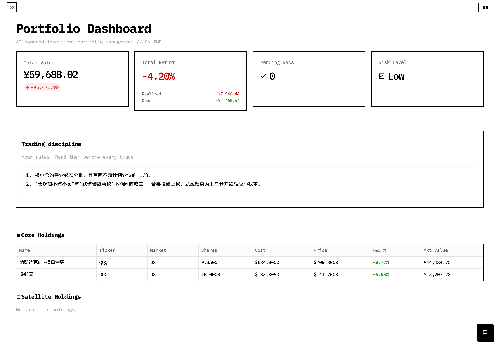
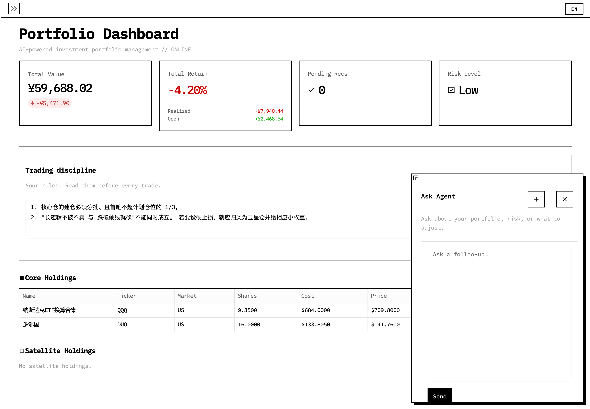
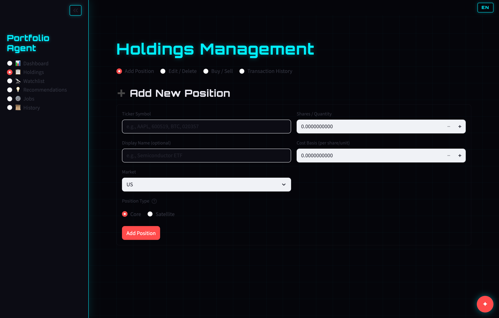
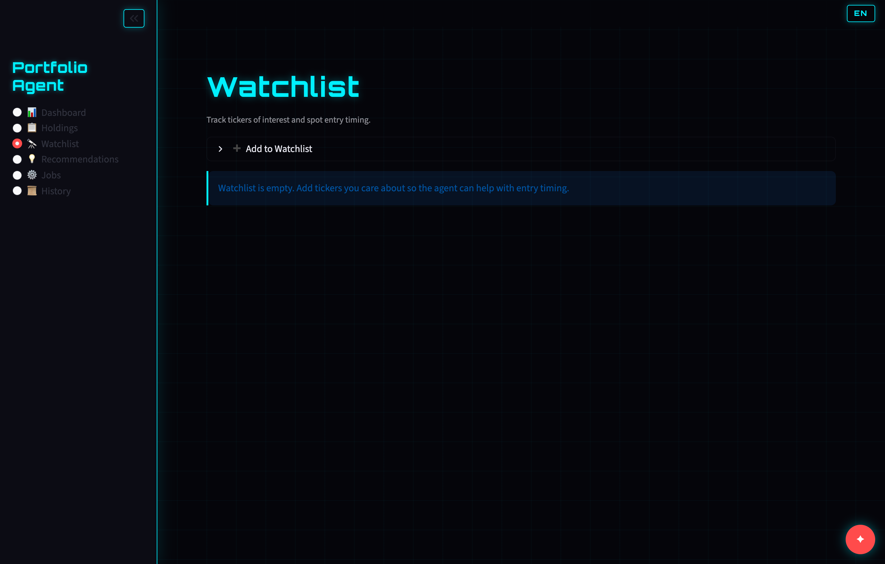
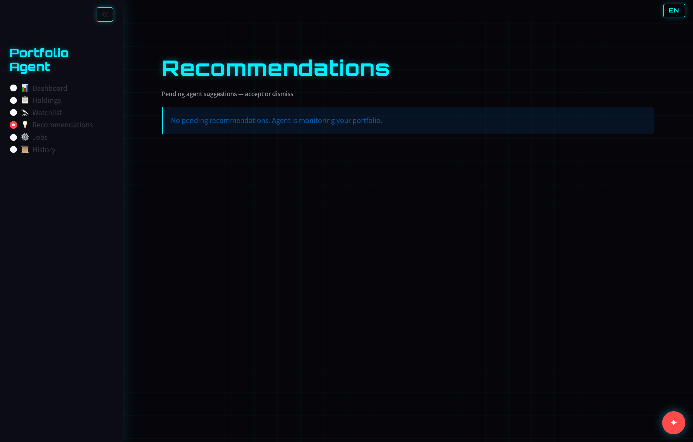
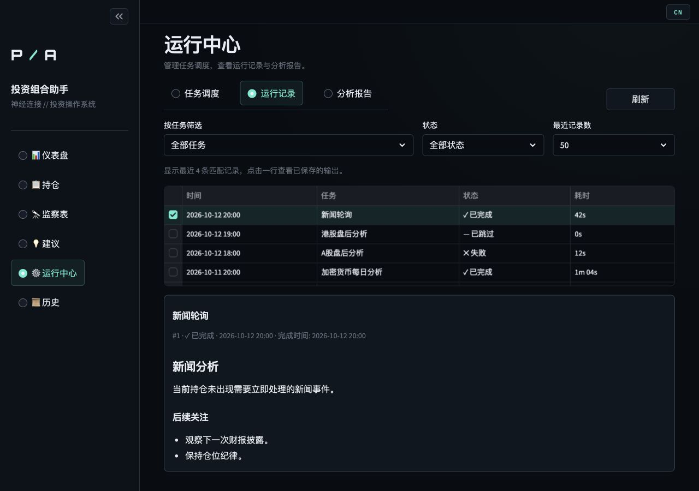
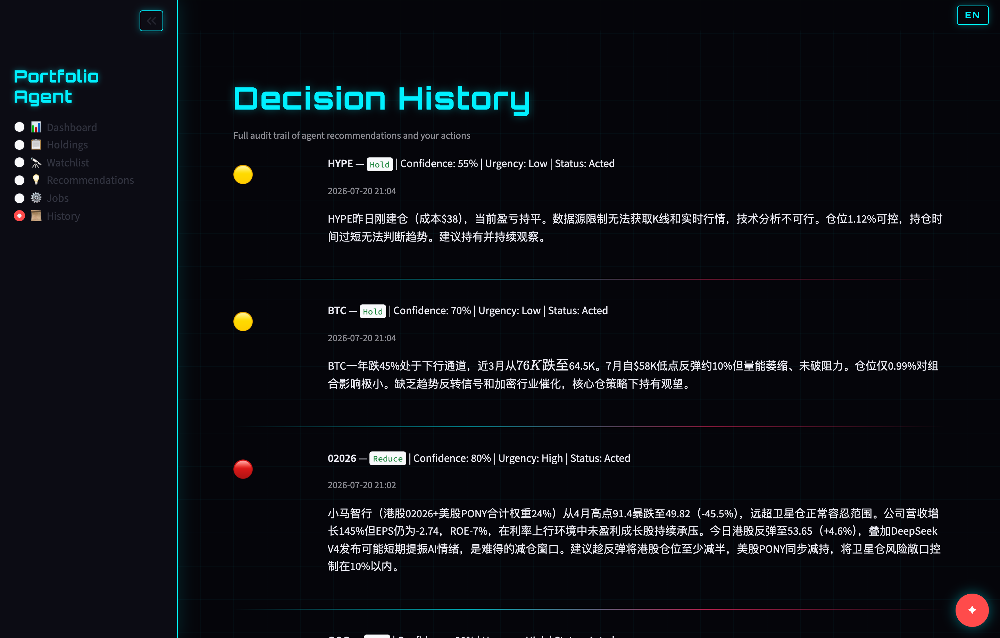
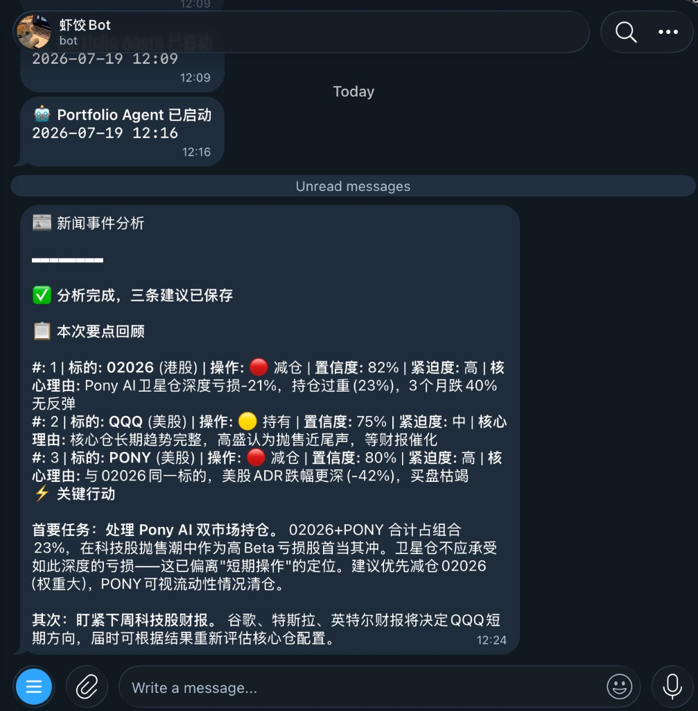

# Portfolio Agent（投资组合助手）

[English](README.md)

面向 **美股 / A 股 / 港股 / 加密货币** 的个人投资组合系统：赛博朋克风格 Streamlit 仪表盘、DeepSeek 思考模式 Agent（LangGraph + 工具）、实时行情、定时分析，以及可选 Telegram 通知。

本地启动后打开 [http://localhost:8501](http://localhost:8501)。

## 界面展示

截图来自正在运行的产品页（`http://127.0.0.1:8501`，英文界面；右上角 **EN / CN** 可切换中文）。

### 仪表盘

人民币口径总市值与盈亏、待处理建议数、风险等级，以及 **核心仓 / 卫星仓** 持仓表（实时价格）。右下角红色星标是 **Ask Agent**。



### Ask Agent

全局浮动对话，任意页面可问持仓、风险或调仓。多轮追问共用一条会话，点 **新对话** 才新开。左上角拉伸点缩放窗口，输入框随面板变高。



### 持仓

按代码与市场新增仓位；支持 **编辑 / 删除**、**买入 / 卖出**（买入加权成本，卖出按券商常见残馀成本），以及完整成交流水。清仓后记录仍保留。



### 监察表

建仓前跟踪标的：理由、可选目标区间，可改理由或删除。



### 建议

待处理建议含置信度、紧急度与推理。在此 **接受 / 忽略**（Telegram 只推送文本，避免与其它 Bot 抢 `getUpdates`）。空状态表示 Agent 在监控，不会刷例行持有。



### 运行中心

分为三个视图：**任务调度** 管理六个定时任务并支持立即运行；**运行记录** 可按任务和状态筛选，点击记录查看已保存的输出；**分析报告** 集中查看报告正文、建议和工具调用。月度总结与新闻轮询设置默认收起。时间按 `APP_TIMEZONE`（默认北京）。



### 历史

建议与操作的审计轨迹：标的、动作、置信度、紧急度、状态、时间与决策理由。



### Telegram

分析完成后可选推送（纯文本）。接受 / 忽略只在仪表盘完成。



## 功能

- **多市场持仓**：美股、A 股（含场外基金 / ETF）、港股、加密；核心—卫星
- **人民币组合口径**：市值与权重按汇率折算（成本与现价保留原币种）
- **深度思考 Agent**：`deepseek-v4-pro` + 思考模式 + LangGraph 工具循环
- **Ask Agent**：浮动多轮对话、流式回复，运行中心可查分析报告
- **行情容错**：先缓存再刷新；适配器失败降级，不拖垮定时任务
- **定时分析**：分市场盘后、新闻轮询（持仓 + 头条）、月度交易复盘
- **决策落库**：会话、工具调用、建议与用户操作写入 SQLite
- **双语界面**：右上角 **EN / CN**
- **Telegram**：可选启动欢迎与分析摘要
- **公网门禁**：`AUTH_ENABLED` + 密码；连续失败后 IP 拉黑

## 页面

| 导航 | 用途 |
|---|---|
| **仪表盘** | KPI 与持仓表；打开 Ask Agent |
| **持仓** | 新增 / 编辑 / 买卖 / 成交流水 |
| **监察表** | 未持仓标的、理由、目标区间 |
| **建议** | 接受或忽略待处理建议 |
| **运行中心** | 日程、立即运行、crontab、日志、会话详情 |
| **历史** | 过往建议与处理结果 |

## 一键部署（Ubuntu）

自动安装 venv 与 systemd 服务：

```bash
sudo apt update && sudo apt install -y git
sudo git clone https://github.com/panyangbaise-bit/portfolio-agent.git /opt/portfolio-agent
cd /opt/portfolio-agent
sudo ./deploy/setup-server.sh
sudo nano /opt/portfolio-agent/.env   # 填 DEEPSEEK_API_KEY 与 AUTH_PASSWORD
sudo systemctl restart portfolio-agent
```

访问 `http://你的服务器IP:8501`。日志：`journalctl -u portfolio-agent -f`。

## 使用方法

1. **本地安装与配置**
   ```bash
   pip install -r requirements.txt
   cp .env.example .env
   # 必填：DEEPSEEK_API_KEY
   # 可选：TELEGRAM_BOT_TOKEN、TELEGRAM_CHAT_ID、APP_TIMEZONE=Asia/Shanghai
   ```

2. **启动**
   ```bash
   ./run.sh
   ```
   打开 http://localhost:8501。

3. **添加持仓** — **持仓 → 新增**（美 / A / 港 / 加密，核心或卫星）。后续成交用 **买入 / 卖出**，账本才一致。

4. **建仓前跟踪** — **监察表** 记录尚未买入的标的。

5. **查看组合** — **仪表盘** 看人民币总市值、盈亏与风险；点星标打开 **Ask Agent**。

6. **处理建议** — **建议** 页接受或忽略；完整记录在 **历史**。

7. **运行分析** — **运行中心** 页看下次执行时间，或点 **立即运行**。结果在运行日志、会话详情，以及配置好的 Telegram。

## 快速开始

```bash
pip install -r requirements.txt
cp .env.example .env
# 在 .env 中配置 DEEPSEEK_API_KEY
./run.sh
```

公网部署前设置 `AUTH_ENABLED=true` 与 `AUTH_PASSWORD`。连续输错密码后，客户端 IP 会写入 `data/ip_blacklist.json`。

## 验证

```bash
PYTHONPATH=. python3 -m pytest tests -v
```

## 设计文档

完整设计见 [docs/superpowers/specs/2026-07-18-portfolio-agent-design.md](docs/superpowers/specs/2026-07-18-portfolio-agent-design.md)。
