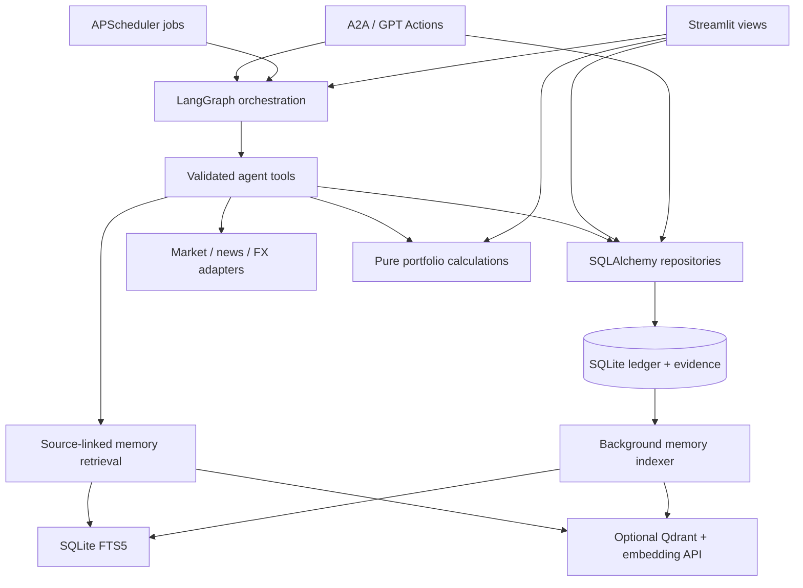

# Architecture

Portfolio Agent is a single-process, layered Python application. Streamlit,
scheduled jobs and the external API share one ledger and one agent runtime.
Keeping these together suits a personal deployment; the design does not claim
multi-tenant isolation or distributed scheduling.

## Module boundaries

| Module | Owns | Dependency rule |
| --- | --- | --- |
| `domain/` | Average-cost ledger replay, portfolio totals, market currencies | Standard library only; no database, HTTP, UI or configuration imports |
| `adapters/` | Provider requests, normalization, timeouts and FX fallbacks | No Streamlit or UI imports |
| `agent/` | Graph state, prompts, tool schemas, bounded execution, sessions and citations | Uses domain/adapters/repositories, never the UI |
| `db/` | ORM records, migrations and repository operations | Authoritative business data; no rendering |
| `memory/` | Immutable evidence capture, outbox indexing and retrieval | SQLite is authoritative; search indexes can be rebuilt |
| `scheduler/`, `notifier/`, `a2a/` | Background triggers, delivery and external protocols | Invoke shared application logic; no UI dependency |
| `common/` | Shared UTC/display-time helpers | No presentation dependency |
| `app/` | Authentication, session state, caching and rendering | Each view exposes `render()`; navigation selects from a fixed module list |
| `runtime.py` | Infrastructure initialization and service lifecycle | Composition root; starts resources explicitly and closes in reverse order |

`tests/test_architecture.py` checks all backend imports, including function-local
imports, so a new dependency on `app` or `streamlit` fails the suite. The old
`app.fx`, `app.timeutil` and `app.components.portfolio_valuation` paths remain as
small compatibility exports. New code imports the canonical modules above.

## Lifecycle and entry points

| Entry point | Startup behavior |
| --- | --- |
| `./run.sh` / `streamlit run app/main.py` | Authenticate first, then start the memory worker and scheduler once per process |
| `python server.py` | Initialize storage, adapters, worker, scheduler and configured API before launching Streamlit |
| `python -m a2a.serve` | Initialize storage/adapters and the configured API only |

The runtime lock lives in an imported module, so Streamlit script reruns and
concurrent browser sessions reuse it. Adapter registration is no longer treated
as proof that all services started. Failed startup unwinds background services;
a later call may retry. Imports of `server` and `runtime` do not start services.
The memory worker has bounded shutdown waiting; if an in-flight provider call
has not finished, a restart fails explicitly until the old worker stops.

The production entry point closes resources in `finally` and registers one
process-exit cleanup handler. API shutdown releases the listening port. Optional
Telegram delivery failure is logged without aborting a healthy application.

## Data and execution contracts

- **Return accounting:** holding rows use broker residual cost. Total portfolio
  return replays the transaction ledger, includes closed-position realized gains,
  and avoids counting partial-sale gains twice. Missing FX rates prevent a false
  CNY total. These calculations are shared by the UI and agent.
- **External data:** dashboard quotes render from persisted snapshots and refresh
  with a deadline. Provider errors become explicit degraded results. A timeout
  stops waiting; it cannot forcibly cancel an already-running Python thread.
- **Agent execution:** overall runtime, individual tool calls, repeated identical
  calls and reasoning rounds are bounded. Tool activity and final reports are
  persisted against the actual session rather than a model-supplied ID.
- **Memory:** business mutations and evidence snapshots commit together. The
  worker performs external embedding calls outside business transactions, with
  bounded batches, retries and cached embeddings. Historical queries distinguish
  event time from when evidence became known.
- **Access:** Google OIDC checks verified identity and an exact email allowlist.
  External protocols use separate bearer-token gates and read-only tool access.
  “Accept” records a recommendation decision; the project does not submit broker
  orders.

## Tradeoffs and next steps

SQLite and process-local scheduling keep deployment small, but running multiple
application workers can duplicate scheduled jobs. Horizontal scaling would need
an external scheduler/queue, shared locks and a database migration strategy.
Market data can be stale or unavailable; cached and cost-basis fallbacks are not
live-price guarantees. Model output remains advisory. The suite verifies behavior
and integration contracts, not investment performance or model factual accuracy.

A sensible next extraction is splitting the large tool catalog and repository by
business capability. Do that when their change patterns warrant it, retaining
current schemas and transaction boundaries; replacing every function with a class
would add indirection without solving those concerns.
