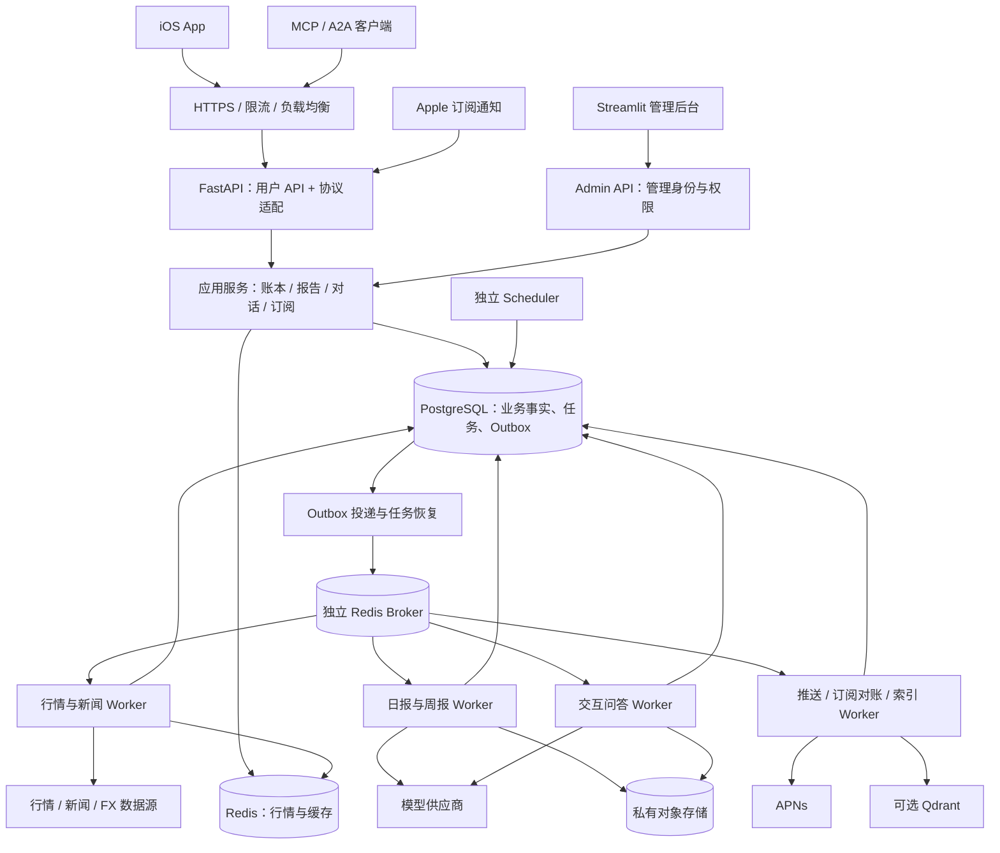

# Portfolio Agent：面向 iOS 与 1 万日活的后端重构方案

日期：2026-10-23。状态：规划草案，未修改业务代码、数据库或部署。

上架约束更新：用户计划先使用个人 Apple Developer 账号。必须结合 [App Store 与中国大陆发行补充方案](app-store-release-plan.md) 执行；当前“个人主体 + 云端持仓 + 个性化投资分析 + 新闻订阅”尚未完成主体/资质核实，不能标为可直接上架。以下是可复用技术目标，不代表各项功能均已获准公开提供。

代码基线：后端 `71c553f`；独立 iOS 仓库 `3b9eaf3`。依据当前源码与已确认的 iOS 产品约束；容量和工期均为规划假设，不是已经取得的性能结果。

## 1. 目标与关键决策

产品主入口为原生 iOS。现有 `portfolio-agent` 仓库继续承载 Python 业务后端、后台管理和外部协议；`portfolio-agent-ios` 承载 SwiftUI。Web 用户功能分批退出，最终保留内部管理界面。MCP 是访问同一后端的协议入口，不依赖 Web 页面存在。

第一版保持：手工录入；A 股、基金、港美股、可明确报价的黄金产品；无 Crypto、自动导入和交易下单。首页展示统一内容流；日报、周报自动产生，历史在复盘页；新闻订阅后由服务端决定推送，并进入复盘窗口；Ask Agent 独立全屏。每份日报/周报免费追问 3 次，会员不限次数。

建议技术决策：

| 层 | 选择 | 作用 |
| --- | --- | --- |
| 应用架构 | 模块化单体、多个运行进程 | 同一 Python 代码库，API、Worker、调度器、Admin 分开运行与扩容 |
| 移动端接口 | FastAPI + Pydantic + OpenAPI | 明确响应模型、鉴权、分页、版本；iOS 使用 REST，问答增加 SSE |
| 业务存储 | 托管 PostgreSQL + SQLAlchemy + Alembic | 账户、账本、报告、会话、权益和任务状态的唯一业务事实源 |
| 缓存 | Redis | 共享最新行情、短期缓存、速率限制；丢失后可以重建 |
| 异步执行 | Celery + 独立 Redis Broker | 按工作类型分队列；PostgreSQL 保留任务和 Outbox，支持重投与恢复 |
| 时间调度 | 单独的调度进程 | 初期复用 APScheduler 的时间触发，只创建任务，不执行 AI |
| 文件 | 私有对象存储 | 大型报告证据、图表、导出文件、备份；签名访问与生命周期管理 |
| 记忆检索 | PostgreSQL 证据 + 可重建检索索引 | 迁移 SQLite FTS；现有 Qdrant 按需求保留，初期不把向量检索设为核心链路依赖 |
| 后台 | 先改造 Streamlit | 经 Admin API 管理业务；逐步消除页面直接写库、直接触发线程的路径 |

保留现有 SQLAlchemy、domain、Agent 和适配器投资，因此推荐 FastAPI。Django Admin 对管理 CRUD 有价值，但为它整体切换 ORM、身份与迁移框架会扩大本轮范围。微服务、Kubernetes、分库分表、Kafka、数据仓库留到实际负载证明需要时再评估。

## 2. 源码评估：复用范围与当前阻碍

| 位置 | 当前事实 | 重构处理 |
| --- | --- | --- |
| `domain/valuation.py`、`domain/instruments.py` | 已抽出估值、账本回放、代码命名空间，和 UI 解耦 | 保留规则与测试；增加 Decimal、初始快照、收益版本与完整度；取消缺价用成本替代的生产展示逻辑 |
| `adapters/` | 已有行情、新闻、FX、超时降级；部分缓存仅进程内 | 保留接口与标准化逻辑；统一标的 ID、共享缓存、供应商额度和能力目录 |
| `db/models.py` | Holding、Transaction、会话、记忆等无 user_id/account_id；金额 Float | 新建多用户 PostgreSQL 模型，不靠只改 DATABASE_URL 完成迁移 |
| `db/repository.py` | 大量查询读取全量组合；函数内 commit；apply_trade 无行锁；成本采用券商摊薄口径 | 强制用户上下文；事务边界移至应用服务；账本幂等、并发锁、事件与投影分离 |
| `db/models.py: PriceCache` | 唯一约束是 ticker + date，未包含 market | 改为 instrument_id + 时间 + 价格类型/来源；避免跨市场或基金代码冲突 |
| `db/migrate.py` | 自定义迁移，异常可能记录后跳过；含历史补初始买入逻辑 | Alembic 显式版本迁移，失败中止发布；旧库作为导入来源 |
| `runtime.py`、`server.py` | Web 进程持有调度、索引线程和外部 API 生命周期 | 拆成 API、Worker、Scheduler、Admin 四类入口；导入无副作用；迁移是发布步骤 |
| `scheduler/` | 进程内 APScheduler、手动任务状态字典、配置写 JSON | 调度配置与运行状态入库；去重、补跑、租约；市场日历替代仅周末判断 |
| `a2a/server.py` | ThreadingHTTPServer、全局 token；任务/context 内存字典；working 上限 4 | 保留协议兼容逻辑，接入统一身份、用户任务和持久化运行状态 |
| `agent/` | 已有工具白名单、引用、运行记录、轮次与超时保护 | 复用；显式用户/报告上下文、模型额度、Worker 隔离、持久化执行 |
| `agent/core.py` | 超时后不再等待线程，不代表模型/线程已停止 | 加供应商请求超时、Worker 执行租约与结果提交校验；避免迟到结果再次写账/扣额度 |
| `memory/` | 业务证据与索引 Outbox 已有；FTS5、BEGIN IMMEDIATE、SQLite insert 是方言依赖 | 保留证据模型，改 PostgreSQL 锁/索引器；搜索、引用回读、向量过滤全部加用户隔离 |
| `app/auth.py` | Google OIDC + 邮箱白名单，适合现有私有 Web | 管理身份保留为独立体系；新增移动端用户身份与会话，不复用管理员身份 |
| `notifier/telegram.py` | 现有通知渠道 | 抽象 Delivery 服务，新增 APNs；Telegram 可留作内部告警 |
| iOS `AppStore.swift` / `Models.swift` | 固定报价/报告，本地 JSON，演示会员；卖出保持平均单价 | UI 保留，数据源替换；不把本地计算和 demoSubscriber 当作服务端事实 |

当前代码分层和测试值得保留，主要工作是把个人工具的隐含全局状态改成显式的用户、账户、任务和版本边界。

## 3. 目标架构

逻辑模块不等于独立微服务。API 与 Worker 使用相同业务包，通过 PostgreSQL 的事务和版本协调；只有外部 API、管理入口和耗时任务分进程部署。

API 不等待日报生成，不逐标的请求上游行情，也不在 Web 请求里跑整段 Agent。接口读取已准备的数据，接受写入或创建持久化任务后尽快返回。

同步 SQLAlchemy 可以先保留：同步处理放在同步路由/受限执行池中，SSE 使用异步通道；不在 async 路由中直接调用阻塞 ORM 或供应商 SDK。连接池预算按“API 副本 × 进程 × pool + Worker + 后台”统一计算。多进程内存独立，不能继续用 Python 全局字典保存共享任务。[FastAPI 部署说明](https://fastapi.tiangolo.com/deployment/concepts/)

## 4. 1 万日活的容量模型

DAU 不是并发数，也不是每天必须生成报告的用户数。以下是第一版压测输入，发布前按真实产品策略更新。

| 指标 | 基准假设 | 验证方式 |
| --- | --- | --- |
| 注册用户 | 5 万 | 身份与长期数据规模 |
| 日活 | 1 万 | 每人每日约 40 次 API 请求，合计 40 万/日，平均约 4.6 RPS |
| 峰值 API | 200 RPS 持续 30 分钟；500 RPS 突发 5 分钟 | 混合读写压测，不由平均值直接推定 |
| 前台活跃行情页面 | 500 个；每 15 秒批量刷新一次 | 约 33 次客户端请求/秒，包含在 API 峰值预算内 |
| 持仓 | 每个注册用户 20 项，约 100 万行 | 分用户索引、批量关联查询 |
| 每日待生成报告 | 基准 1 万份；另测 5 万份 | 由有持仓且启用报告的用户决定，不仅是当天活跃者 |
| 热门唯一标的 | 5,000 个 | 按唯一标的拉取，不能按用户 × 持仓数抓取 |
| AI 对话 | 约 7,000 次/日，突发 2,000 次/15 分钟 | 约 2.2 个请求/秒；若每次占用 45 秒，需要约 100 个并发模型调用 |

自动报告必须有独立参数 `report_enabled_users`。建议首发对所有启用报告且有有效持仓的用户生成；空组合不发无意义分析。若未来按活跃度暂停免费自动报告，这是单独的产品决策，不能为了满足 1 万份容量假设偷偷改变权益。

报告容量示例：每份日报 1 次模型摘要、6,000 输入 token、800 输出 token、平均 30 秒。1 万份在 2 小时内完成，平均约 42 个并发调用；考虑重试与波动先以 64 个报告并发槽位压测。若平均耗时变为 60 秒，则需要约 84 个基础并发、约 126 个带余量槽位。每个槽位不应在等待模型时长期占用数据库连接。

同一示例每天日报消耗约 6,000 万输入、800 万输出 token；2 小时窗口约 56.7 万 token/分钟、83 次调用/分钟。5 万报告用户时放大到 5 倍。上述未包含周报、问答、新闻、重试；多轮 Agent 还要乘实际调用轮数。因此模型供应商 TPM/RPM、配额和单用户成本是上线条件，增加机器不能替代这些配额。

成本按实际合同单价计算：

`日成本 = 各工作类型的输入 token × 输入单价 + 输出 token × 输出单价 + embedding + 行情/新闻授权 + 云资源/存储/带宽`。

先记录每份报告、每次问答、每个活跃用户和每个付费用户的成本，不在此阶段编造固定月费用。行情授权和 AI 费需要单列，不能只看服务器账单。

## 5. 数据模型与账本语义

### 5.1 表的业务边界

| 领域 | 主要表 | 必要约束 |
| --- | --- | --- |
| 用户身份 | users、identities、auth_sessions、user_preferences | provider + subject 唯一；刷新 token 哈希、轮换与撤销 |
| 投资账户 | portfolios、accounts | 一个用户默认一个组合、多个手工账户；预留多组合 |
| 标的目录 | instruments、instrument_identifiers、provider_symbols、instrument_capabilities | 内部 ID 稳定；交易所/市场、类别、代码明确；基金份额类别独立 |
| 账本 | ledger_events、positions、position_versions | account + instrument 唯一当前投影；事件不可覆盖；冲正/修正显式记录 |
| 行情 | latest_quotes、daily_prices、fx_rates、market_calendars | instrument_id + as_of + kind + source；完整记录发布时间与抓取时间 |
| 估值 | portfolio_snapshots、snapshot_positions | 账本版本、行情与 FX 版本、收益算法版本、缺失覆盖率 |
| 复盘 | reports、report_revisions、feed_items、report_read_states | user + portfolio + kind + period 唯一逻辑报告；重生成增加修订版 |
| 对话 | conversations、messages、ai_runs、run_events、usage_reservations | 报告追问绑定 report_id；自由对话单独类型；幂等请求、运行与消费关联 |
| 订阅 | subscription_products、store_transactions、subscription_events、entitlements、entitlement_grants | 环境 + store transaction 唯一；来源可追踪；人工赠送独立于 Apple 交易 |
| 新闻 | news_events、news_instruments、user_news_deliveries | 公共事件去重；每个用户的筛选理由和投递状态独立 |
| 推送 | devices、notification_preferences、notification_deliveries | token 区分环境与 app topic；解绑用户、失效移除；投递唯一键 |
| 运维 | jobs、job_attempts、outbox_events、admin_audit_logs、feature_flags | 业务幂等键、执行租约、重试、审计与版本 |
| 记忆 | memory_documents、memory_chunks、index_jobs | 私有证据归属明确；索引可删可重建，不做事实源 |

用户私有表都带 `user_id`，子记录以 `(user_id, parent_id)` 复合外键防止跨用户错误关联。价格、市场日历、公共新闻等可共享，但共享行情缓存还需包含数据源授权级别，不能将仅供某类用户使用的数据无条件广播。

UUID 可用于外部 ID；金额/数量使用 Decimal 对应 PostgreSQL NUMERIC。初步数量 `NUMERIC(28,10)`、单价/汇率 `NUMERIC(28,12)`、金额 `NUMERIC(28,8)`，最终按支持标的校准精度与舍入规则。JSON 中传十进制字符串，Swift 用 Decimal，不依赖 Double 保证金额一致。时间存 UTC TIMESTAMPTZ，另外存交易市场交易日、用户时区及 `occurred_at` / `recorded_at`。

### 5.2 成本与收益先统一

现有 Python 的持仓成本会随卖出收益摊薄，iOS 演示版卖出时保持平均买入成本；Python 总收益又通过成交回放计算。这些字段不能直接同名映射。

建议正式版的权威账本使用移动加权平均成本，并分开输出：平均取得成本、已实现收益、未实现收益；券商显示的摊薄成本作为可选独立指标，不混入平均成本字段。

例：100 份 × 10 元，卖出 50 份 × 12 元。平均取得单价仍是 10 元，已实现收益 100 元；券商摊薄单价可为 8 元。若剩余市价 12 元，未实现收益为 100 元，总收益 200 元。两种“成本”可以共存，但 UI、日报、AI 必须知道各自口径。

手动输入“当前持有多少、成本多少”是 `opening_snapshot`，不是一笔真实买入；起点之前的交易史和历史收益未知。后续 `buy/sell` 才是实际记录。暂不构造不存在的现金余额或完整历史收益曲线；有数据不足时输出 `incomplete`。

外币资产分别记录原币成本与收益、历史现金流/成本的 FX 依据、估值日 FX。不能把所有已实现收益乘今天汇率后命名为准确历史人民币收益。缺历史 FX 时展示原币收益及可计算部分，人民币历史收益标记不可得。分红、拆股、费用建立事件类型和修正入口；首次上线只展示已支持且有依据的收益指标。

### 5.3 写入事务

手工记录交易：认证用户 → 校验账户归属与标的能力 → 检查 Idempotency-Key 和请求摘要 → 锁定对应 position → 校验账本版本、数量与日期 → 写 ledger_event、更新投影/版本、写 Outbox → 单次提交。

同一幂等键不同内容返回冲突；相同内容重试返回首次结果。两个设备同时卖出不得各自通过库存检查。首版沿用 iOS 的顺序录入限制；补历史交易要经显式重放和新报告修订，不能直接改旧持仓行。初始建仓并发冲突通过唯一约束解决。

## 6. 多用户隔离与身份

第一版每个自然人账户就是隔离单元，无需提前建设复杂企业组织租户模型。iOS 建议先提供 Sign in with Apple；手机号验证码可在国内运营需求明确后增加，并做账户绑定与防重复。身份 ID 使用稳定 subject，不使用邮箱当主键。未登录可体验独立样例模式。

所有 API 从验证后的身份推导 user_id，绝不接受请求正文中任意 user_id 作为权限依据。短期 access token + 可撤销的轮换 refresh token，iOS Keychain 保存凭据；退出时解绑推送设备与清理私有缓存。

应用服务、仓储、Agent 工具都必须接收可信的 RequestContext（用户、权限、请求 ID）。模型不能通过 tool 参数切换用户。Worker 从服务端写入的任务记录恢复上下文，不信任任意队列载荷。全局无范围的 `get_all_holdings()` 等接口不向新业务暴露。

PostgreSQL 对私有表启用 RLS，事务内设置用户上下文；缺失上下文拒绝访问。服务账号不使用 superuser、表 owner 或 BYPASSRLS；表 owner 必要时 FORCE RLS。连接池复用时使用事务局部设置，防止把上一个请求的用户身份带给下一个用户。RLS 作为第二道防线，仍需应用层授权和复合外键。[PostgreSQL RLS 文档](https://www.postgresql.org/docs/current/ddl-rowsecurity.html)

隔离必须覆盖：SQL 查询、Redis key、SSE 订阅、任务恢复、报告证据、对象下载、搜索索引、Qdrant 过滤、引用回读和日志。向量结果先带用户过滤，再回 PostgreSQL 校验归属；缓存 key 包括用户/组合版本，公共行情缓存是显式例外。匿名用户和管理员不能绕过普通用户的数据范围。

## 7. 行情、基金净值和黄金的准入

将“可录入”做成服务端可审计的能力目录，不能只靠 iOS 的 available 布尔值。至少包括：instrument_id、asset_class、market、currency、quote_kind、provider、supported、authorization_tier、freshness_policy、coverage_status、unsupported_reason。

用户已有要求是必须能实时追踪才允许录入。不能把日更净值悄悄称作实时价格：

- 股票/ETF：区分实时授权行情、延迟行情、收盘价，返回实际价格时间和交易状态。
- 场外基金：正式净值按基金公布节奏更新；盘中估值不是正式净值。若“实时”按盘中实时成交价严格执行，场外基金应暂不开放新增；如果产品允许自动跟踪最新正式净值，则在确定这一例外后开放并明确标注。这是待确认的产品定义，方案不默认放宽。
- 黄金：必须落到具体可报价产品，例如黄金 ETF 或明确交易市场的标准品；银行积存金、实物金不能直接套通用金价计算可变现价值。
- Crypto：移动端目录、行情调度、报告与入口都关闭，旧库数据迁移时保留归档，不静默丢弃。

采集端按唯一标的/市场批量刷新，报价一次供多个用户读取；冷门产品按需入采集目录并合并并发请求。活跃页面批量读取持仓快照，15 秒刷新是客户端轮询初值，不代表对所有市场承诺 15 秒实时行情。

行情过期或源失败时保留最后有效价格及时间并显示失效状态，不拿成本价补“当前市值”。总估值不完整时显示覆盖率与缺失项。源暂时不可用不删除已有持仓；按严格准入策略暂停新增，记录已有持仓的交易并保留未估值状态。

本轮不调用数据供应商做覆盖验证。商业行情/新闻的数据使用、分发范围与供应能力是正式接入前需要独立完成的工作，不能由当前 AkShare/yfinance 可运行推导出对 1 万用户稳定可用。

## 8. 日报、周报、新闻与 AI

### 8.1 日报流水线

市场行情/新闻公共采集 → 数据就绪检查 → 用户账本与行情快照 → 确定性收益/贡献/集中度计算 → 单次模型摘要 → 数值/引用校验 → 报告与 feed_item 原子发布 → Outbox 触发推送。

相同标的的市场事实与新闻摘要可以共享；用户持仓和私有对话不在不同用户间复用。模型负责解释，不负责计算收益，也不负责决定谁有权限读哪份报告。摘要保留数据时间、算法、模型、提示词版本和证据引用。校验失败回退为事实型总结并标注分析未完成，不发布错误数字。

日报不默认运行现有最多 12 轮的完整自主 Agent；周报可使用更多历史上下文，但仍有明确检索和调用预算。自由 Ask Agent 才保留受限工具探索。

### 8.2 跨市场时间

建议统一每位用户每天一份组合日报，内部记录 CN/HK/US/基金各自截止时间，避免一天按三个市场各发一次完整报告。默认可沿用 iOS 的北京时间 08:00，用户修改时间后按可用数据生成；市场数据准备使用交易所日历、当地收盘、夏令时和基金公布节奏，而非固定北京时间 + 周末判断。

“每天有内容”与“每天有交易”分开。休市日可生成持仓变化/本周进度简报并标注休市，不虚构收盘收益；未公布基金净值明确列出。周报按明确自然周周期汇总，建议周一早上送达上周复盘；同一时段日报和周报可合并一条系统通知，App 仍保留两份独立报告与各自追问额度。用户原有推送开关继续有效。

### 8.3 Ask Agent 与报告追问

`conversation.kind = free_chat | report_followup`；报告追问固定引用当时快照，用户主动要求最新数据时追加带时间的新证据，不能改写原报告。

问答提交返回 `202 + run_id`；SSE 传队列/工具进度/文本，断网后用 run_id 查询并按 event_id 重连。任务不依赖 iOS 长连接存活。最终回答先入库，再通知完成；同一会话首版仅允许一个正在执行的问题，其他请求排队或返回明确状态。

免费 3 次以稳定 report_id 为额度范围，重新生成报告不能重置额度。事务中预占次数，成功保存完整回答后核销，系统失败释放。并发请求不能同时使用“最后一次”；重复网络请求不再次扣除。客户端掉线但后台成功，仍计一次，可重取同一回答。预占要有租约和恢复机制，晚到 Worker 不得在已释放预占后覆盖状态。

会员保持“次数不限”的产品约定；可以明确设置同时运行数量、输入长度和请求速率，以保证公平使用，但不私设每日总次数上限。模型失败或预算保护触发时应显示服务降级/排队状态，不能把未执行请求扣作有效追问。

### 8.4 新闻订阅

只对开通权益的用户做个性化监测。按唯一标的采集和去重，再用持仓反向索引筛选可能受影响的用户；先规则筛选，确有需要才模型分析。设置事件去重、重要性、安静时段和合并通知；不是每一条新闻 × 每一位用户都调用模型。

日报/周报内可引用新闻证据；订阅新闻摘要通过 feed_item 进入当前复盘窗口并跳转详情，不增加主页面的主动检查入口。

## 9. 任务可靠性

任务至少执行一次，业务副作用只提交一次；不承诺供应商调用严格 exactly-once。创建任务与业务事件写入同一 PostgreSQL 事务，Outbox Dispatcher 投递；即使入队成功但标记失败后重投，也由任务幂等键吸收。

建议队列：interactive_ai、daily_reports、weekly_reports、market_data、news、notifications、subscription_reconcile、memory_index。交互问答和日报分别有资源配额，行情与推送不被 AI 长任务占满。

`jobs` 保存 queued/running/succeeded/failed、attempt、lease_until、heartbeat、next_retry_at、input_hash。Worker 以租约认领，提交结果时校验 attempt/fencing token。过期任务可恢复，晚到旧 Worker 的结果被拒绝。给 report/user/period、notification/user/event、subscription/event 都设业务唯一键。

重试仅用于可重试错误，指数退避与抖动，达到上限进入待处理列表。后台批量补跑有数量上限、费用预估和审计。供应商调用放在事务之外；只在认领/结算时短暂持有 DB 锁。

调度器单独运行一个有效 leader，数据库锁/租约防重复；记录 next_due_at，用补扫恢复错过的时点。数据库唯一约束兜底。不要在每个 API 副本启动 Scheduler，也不要为每个用户创建常驻线程。

Redis Broker 与缓存使用独立实例/资源配额，Broker noeviction、持久化与监控；DB 任务恢复负责处理队列丢失。任务硬超时必须小于配置的 visibility timeout；远期任务时间存在 DB，不放长时间 ETA 消息。`acks_late` 需要幂等执行，不代替重试策略。[Celery 任务文档](https://docs.celeryq.dev/en/stable/userguide/tasks.html)、[Redis Broker 限制](https://docs.celeryq.dev/en/stable/getting-started/backends-and-brokers/redis.html)

## 10. 会员订阅与管理后台

### 10.1 会员事实与权益

首发付费入口按 iOS StoreKit 2 自动续期订阅设计。后端验证 Apple 签名交易及产品、bundle、环境、有效期、撤销状态和账户绑定；appAccountToken 使用绑定本应用用户的 UUID。客户端 demoSubscriber 和购买成功 UI 都不能直接赋予权益。[Apple appAccountToken](https://developer.apple.com/documentation/appstoreserverapi/appaccounttoken)

接收 App Store Server Notifications V2，验证后持久化再返回成功；后续异步更新订阅状态。事件按 notificationUUID 去重，交易按 transaction ID 去重；乱序通知通过交易时间、到期时间和查询当前状态处理，不以收到时间盲目覆盖。

续订、取消自动续订、到期、退款、撤销、宽限期、账单重试分别建模。“取消续订”不等于立刻失去已支付周期的权益。恢复购买绑定已有交易，避免一份交易重复给多个应用账户开通；账户迁移需单独受控流程。定期调用 Server API 对账并补漏，通知不能作为唯一同步机制。[Apple 订阅通知](https://developer.apple.com/documentation/appstoreservernotifications)、[通知历史](https://developer.apple.com/documentation/appstoreserverapi/get-notification-history)

`entitlements` 输出 ask_agent、news_monitor、report_followup_unlimited 及生效范围/时间，所有入口（iOS、MCP、任务生成）复用同一权益服务。订阅营销优先使用 Apple 官方优惠机制；后台 grant 仅作为审计明确的客服补偿/内部测试设计，不开放兑换码或站外收款开通，不伪造 Apple 付款记录。具体补偿机制也需符合实际发行规则，详见发行补充方案。

### 10.2 Admin 功能清单

| 模块 | 首版后台能力 |
| --- | --- |
| 用户 | 查询用户与账户状态、设备绑定、注销任务；默认脱敏，查看财务详情需特定权限和原因 |
| 订阅 | 查看交易/续订/退款/权益时间线、通知处理记录、对账、恢复购买排查、限时人工赠送 |
| 报告 | 今日应产/已产/失败/延迟、失败原因、查看版本/证据、有限范围重生成 |
| AI | 排队、延迟、调用/工具次数、token 成本、模型失败、运行终止和恢复 |
| 行情 | 支持目录、数据时效、源错误、限额、缺失覆盖率、禁用新增与恢复 |
| 新闻与推送 | 去重/筛选原因、通知渠道接受结果、失败重试、安静时段和用户退订 |
| 运维 | 队列积压、Worker 心跳、数据库/缓存状态、发布版本、功能开关、备份恢复演练 |
| 审计 | 谁在何时查看/改动谁的数据、为何赠送权益/补跑任务、操作前后状态 |

管理认证与用户认证分离，角色至少 owner、support、operations、billing。敏感操作经 Admin API 授权与审计，不能靠隐藏按钮。后台不提供任意 SQL 或直接编辑交易记录的通用表格。密钥配置走部署密钥管理，不在运维页面回显。

Streamlit 第一阶段复用运行记录、报告详情等界面；所有修改改为服务接口。Web 旧持仓与交易页在 iOS 真实录入通过后进入只读，再关闭；旧问答/复盘功能在移动端达到等价能力后退出。最终默认打开运维概览，侧栏按用户/订阅/报告/AI/行情/推送/审计组织。

## 11. iOS API 与 MCP 边界

新用户接口统一 `/api/mobile/v1`，避免与现有 GPT Actions `/api/v1` 路由碰撞；管理接口 `/api/admin/v1`。协议适配共享应用服务，不复制业务规则。

| iOS 页面/动作 | 建议接口 |
| --- | --- |
| 登录与刷新 | `POST /auth/apple`、`POST /auth/refresh`、`POST /auth/logout` |
| 首页 | `GET /home`：组合快照、最新内容窗口、未读与权益摘要 |
| 标的搜索 | `GET /instruments?query=…`：能力、报价类型、是否允许新增及原因 |
| 账户与持仓 | `GET/POST /accounts`、`GET /positions`、`POST /opening-positions` |
| 手工交易 | `POST /ledger-events` + Idempotency-Key + expected_version |
| 行情刷新 | `GET /portfolio/snapshot`：批量估值、as_of、完整度、版本与 ETag |
| 复盘历史 | `GET /feed?cursor=…`、`GET /reports/{id}`、`POST /reports/{id}/read` |
| 证据与新闻 | `GET /reports/{id}/evidence`、`GET /news-deliveries/{id}` |
| Ask Agent | `GET/POST /conversations`、`POST /conversations/{id}/messages` |
| 报告追问 | `POST /reports/{id}/questions`；返回 run_id、剩余额度或权益状态 |
| 问答进度 | `GET /runs/{id}`、`GET /runs/{id}/events`（SSE） |
| 会员 | `GET /me/entitlements`、`POST /subscriptions/apple/sync` |
| 推送/偏好 | `PUT/DELETE /me/devices/{id}`、`PATCH /me/preferences` |

响应带 request_id、数据时间、必要的版本；列表使用游标分页。错误码区分未登录、越权、行情不可用、记录版本冲突、免费额度用尽、排队繁忙。可重试错误带 retry_after；金融和会员写请求不做客户端盲目重试。

AppStore 拆分为 PortfolioRepository、ReportRepository、ConversationRepository、EntitlementRepository；真实客户端与演示客户端实现相同接口。页面继续使用现有布局。服务端维护账本和权益，本地保存阅读缓存与未提交草稿；首版联网确认成功后才记账，不立即引入离线双向合并。

旧 JSON 默认视为演示环境，不自动上传示例组合、示例回答或演示会员。若用户确实录入了真实持仓，提供显式导入预览、来源标记、账户映射、去重和幂等导入流程；没有历史依据的初始持仓保持快照语义。

外部访问继续支持 MCP/A2A，但将当前共享 token 升级为按用户授权、scope、撤销和审计。MCP 初期只读 holdings/transactions/reports，AI 问答遵循同一会员权益和额度。HTTP MCP 使用相应 OAuth 授权发现、资源 audience 与 scope；本地 stdio 桥接器可以迁移到个人可撤销凭据，不分发服务端总 token。[MCP 授权规范](https://modelcontextprotocol.io/specification/latest/basic/authorization)

## 12. 存储增长、部署与可观测性

### 12.1 存储预算

- 1 万日报/天、每份正文与紧凑快照约 30 KB，全年约 110 GB 原始载荷，不含索引、WAL、备份、周报和对话。完整工具返回与新闻内容不要重复塞进每一份报告。
- PostgreSQL 保存结构化报告、索引字段和必要快照；大证据/图表按内容哈希存私有对象存储并引用。共享公共证据可去重，用户私有证据的访问授权不能因共用对象而丢失。
- 不把每次实时 tick 永久存储。保存最新价格和业务需要的日线；若后续保存 5,000 标的 × 390 分钟 × 250 日的分钟线，会达到约 4.88 亿行/年，需要另外设计时序存储/归档，而非让核心交易表承担。
- 初始对 reports、run_events、审计等制定保留与归档策略；预计快速增长的历史表可按月分区，业务幂等唯一键保留在不分区的主记录表。用户账本按账户生命周期保留，不为省空间随意删除。
- Prompt/工具原始 trace 仅保留短期受控诊断副本，默认脱敏；成本与耗时指标长期留存。第三方 tracing 默认不接收完整私人持仓/对话。
- SQLite FTS5 迁移为 PostgreSQL 搜索索引：复用现有中文 bigram 分词得到可索引 token，再验证中文召回；不假定 PostgreSQL 默认配置自动解决中文检索。Qdrant 保留既有适配接口，按实际记忆需求启用并加用户过滤。

### 12.2 部署基线

中国大陆用户优先同地域部署应用、数据库、缓存和对象存储，云厂商/地域依据现有账户、数据供应商连通性和预算确定。模型、Apple 服务的连接可靠性单独实测。上线所需的数据授权、隐私/内容/应用分发要求另列核验，不将“国内部署”当成自动满足所有要求的结论。

以下只是压测起点，不是已证明的硬件保证：

| 组件 | 初始资源与策略 |
| --- | --- |
| API | 2 副本，每副本 2–4 vCPU、4–8 GB，跨故障域，按 CPU/时延扩展 |
| PostgreSQL | 托管主备，4–8 vCPU、16–32 GB，SSD，按 IOPS/连接/锁等待调整 |
| Redis | 缓存和 Broker 分开；各从 1–2 GB 级容量压测并留余量，生产配置高可用 |
| Worker | 行情/通知与 AI 分开；至少 2 个运行实例提供故障恢复，模型并发槽位按第 4 节单独扩容 |
| Scheduler / Dispatcher | 单有效调度器、可恢复投递器；各有健康检查与持久化游标 |
| Admin | 小规格独立实例，限制入口访问，不参与用户 API 的可用性链路 |

优先托管数据服务和容器/进程平台。开发环境可用 Compose；生产必须有健康检查、重启、滚动发布和统一指标。无 GPU 需求，前提是模型通过外部服务调用。API、Worker 与 Admin 的数据库账号分别授权。

PostgreSQL 开启备份与 WAL 连续归档，目标 RPO ≤ 5 分钟、RTO ≤ 60 分钟，并实际演练。主备解决故障切换，不能替代误删恢复。备份有独立访问控制与异地副本；索引从业务事实重建。[PostgreSQL PITR](https://www.postgresql.org/docs/current/continuous-archiving.html)

### 12.3 服务指标

建议首发目标：核心读取 API 服务端 p95 < 300 ms；账本写入 p95 < 500 ms；成功率 ≥ 99.9%（排除有效业务拒绝）。这些目标在数据库、网络和规定负载条件下验收，不包括外部 AI 生成时间。

AI 分别记录接受请求、队列等待、首 token、总时长；容量目标下 p95 排队 < 10 秒，真实模型首 token 与总时长另测。日报就绪目标为既定投递时间前完成 ≥ 99%，缺数据单独记 degraded，不伪装成功。

推送记录 queued、APNs accepted、failed、用户打开等不同事件，不能把 APNs 接受当作设备必达。App 的内容流是报告可见性的依据，通知失败不影响历史可读。[Apple APNs 说明](https://developer.apple.com/documentation/usernotifications/sending-notification-requests-to-apns)

关键告警：报价时效/覆盖率、队列最老任务年龄、任务恢复次数、模型限流/错误/token 预算、报告缺失率、订阅对账差异、推送无效 token、DB 锁/连接/WAL/磁盘、备份恢复失败。日志用 request_id → job_id → run_id → report_id 关联。

## 13. 迁移顺序与回退

### 阶段 0：契约和收益口径

先完成发行范围与主体核实：区分个人记账统计工具和需资质的金融服务，核查持仓新闻与国内 AI 服务要求；保留用户确认 UI，但不把尚未具备条件的功能写进售卖承诺。并行准备隐私/AI 授权、账户删除和 StoreKit 订阅契约。

产出 API OpenAPI 草案、实体关系与收益 ADR、行情准入定义、容量脚本参数；锁定已确认 UI。整理现有测试作为回归基线，固定依赖版本。初始行情/模型通过确定性 fixture 验证流程，不提前做供应商覆盖承诺。

### 阶段 1：平台基础和首个闭环

搭 FastAPI、PostgreSQL、Alembic、用户上下文、基础 RLS、账户/初始快照/交易/幂等、快照 API。改造 iOS Repository，完成“登录 → 选择支持标的 → 手工录入 → 查看估值 → 重启恢复”。此阶段使用明确标注的测试行情；生产开放前必须完成行情准入。

### 阶段 2：行情、后台任务和自动报告

共享行情采集、市场日历、任务/Outbox、Worker、快照、日报周报、feed 和 APNs。将旧 scheduler 从 Web 生命周期移出。先使报告事实和投递可靠，再引入 AI 摘要；以服务端日报替换 iOS 固定报告。

### 阶段 3：真实问答和会员

对话持久化、SSE、报告 3 次追问、模型路由/成本、StoreKit 验证与对账、新闻权益。旧 Agent 工具逐个接入可信用户上下文。完成越权/并发扣费/重试恢复测试后开放真实用户。

### 阶段 4：Admin、迁移和 Web 收敛

管理身份、订阅/任务/行情/推送/成本与审计后台；旧用户 Web 改只读并按页面退出；MCP/A2A 切换统一身份与服务。

当前 SQLite 只有个人账本，采用明确维护窗口迁移更简单：

1. 停止旧账本写入和旧调度器，用 SQLite 一致性备份机制生成快照与校验清单；若启用 WAL，不只复制一个正在写入的主文件。
2. 导入专属 legacy 用户与默认账户；映射标的/旧 ID/时区/精度；保存原始行和迁移批次；Crypto 归档。真实旧数据与 iOS 样例不能合并为同一事实来源。
3. 对 `notes=opening` 和历史补造买入逐项记录来源，不能把所有 opening 都认作真实交易，也不能仅凭字符串盲目删除。无法判定者保留 legacy_semantics 与收益不完整标记。
4. 对账账户/持仓/交易数量、数量余额、原币成本、已实现收益、报告/会话关系、引用可回读与缺失映射清单；新旧口径差异逐项解释，不追求错误数值强行一致。
5. 同一批次导入可重复执行且不重复建账。验收后切换唯一写入口到 PostgreSQL，旧库保持只读备份，停用旧服务所有定时/通知路径。
6. 切换前失败直接恢复旧服务；切换后已有新写入时，回退兼容 PostgreSQL 的上一应用版本，或先对新事件做可验证导出/重放。不能把旧 SQLite 文件覆盖回来丢掉新账。

生产 schema 变更采用 expand → backfill → 验证 → switch → 后续版本清理。与旧 iOS 兼容一个明确窗口，用版本化 API 和功能开关切换；数据库迁移不随每个 API 进程启动执行。

### 阶段 5：容量与小范围发布

先内部用户，再约 100、1,000 用户，最后按压测和真实成本逐步放量至 1 万 DAU。里程碑按能力验收，不把注册人数当压测完成。

在当前代码规模下，粗略估算为 10–16 个工程人周，包含后端、iOS 接入、迁移和基础运维，存在较大不确定性；行情采购、外部配额、商店审核和内容/数据要求另计。适合作为排期讨论起点，不作为固定上线承诺。

## 14. 发布前验收矩阵

| 场景 | 必须证明 |
| --- | --- |
| 用户 A 猜用户 B 的持仓/报告/会话/文件 ID | API、Worker、缓存、SSE、搜索和引用回读均拒绝，无私有数据泄漏 |
| 同一买卖请求重复 10 次；两设备同时卖出 | 只记账一次，无负持仓，无部分成功的账本与投影 |
| 免费报告剩一次，两个请求并发 | 最多一次预占成功；系统失败可恢复；重试不重复扣除 |
| Apple 重复/乱序/丢失回调、退款、恢复购买 | 权益与验证后交易状态一致，不能重复开通或错误剥夺有效期 |
| 日报任务重复投递、Worker 中断、Broker 重启 | 不重复发布/扣额度；可恢复；晚到结果不能覆盖较新执行 |
| 行情缺失、过期、基金未公布、市场休市 | 显示真实时间与缺失，不以成本冒充价格，不虚构当日收益 |
| 200 RPS 持续 + 500 RPS 突发 + 500 行情页面 | 读写延迟与错误率达标，无 N+1、连接耗尽或越权缓存 |
| 1 万报告、5 万报告压力场景与同时问答 | 流水线容量、队列公平性和供应商 TPM/RPM/预算分别达标 |
| 数据库误删或实例故障 | 从备份/WAL 恢复演练达到 RPO/RTO；账本和权益可对账 |
| App 退出、断网重连、升级与账户切换 | 会话/报告恢复，写请求不重复，演示与真实数据不混用 |

流量压测使用合成用户/组合和可控模型替身验证内部吞吐，再用有预算的小样本真实供应商测试校准延迟与 token；模拟结果不能替代真实行情供应和模型配额验证。

## 15. 下一步建议

先完成阶段 0 和阶段 1 的一个纵向闭环：用户/账户/账本 → PostgreSQL → 移动端 API → iOS 持仓页。它会同时验证重构中最关键的身份边界、成本口径、事务与客户端契约。之后再把自动报告、会员、新闻和管理操作逐项迁入。

本方案默认小团队、国内单地域起步、托管基础设施、外部模型服务。需在实施前定稿的产品项：场外基金最新正式净值是否满足准入；日报用户覆盖与默认投递时刻；首发身份方式与会员商品。需在容量验收前补齐的工程项：行情/新闻可用范围、模型 RPM/TPM、云资源预算与恢复演练。
