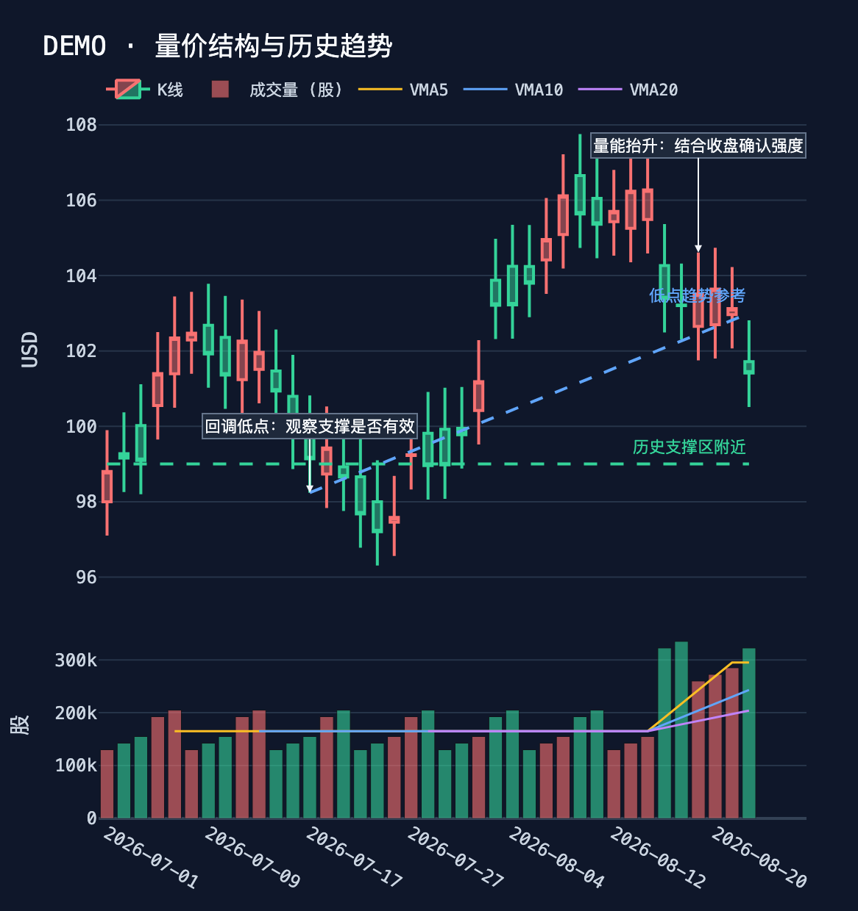

# K 线量能与标注报告

以下是浏览器实际导出的示例图片，使用合成数据，不代表真实行情：



## 量能指标

`get_kline` 保持原来的单标的列表、批量 `results` 结构，在每根数据中增加量能指标。

| 字段 | 含义 |
| --- | --- |
| `volume` | 当前根成交量；无数据为 `null` |
| `volume_ma5/10/20` | 含当前根的 5/10/20 根算术均量 |
| `volume_ratio5` | 当前量 ÷ **前五根**均量，不是盘中量比 |
| `volume_change_pct` | 相对前一根的量变化百分比 |
| `volume_unit` | `lot` 手、`share` 股、`usd` 美元 |
| `volume_kind` | `traded_volume` 成交量、`rolling_24h_turnover` 滚动成交额、`unavailable` 无数据 |
| `series_kind` | `ohlc` 蜡烛、`nav` 净值线、`price` 价格采样线 |

窗口不足、窗口内有缺失值、分母为零时不计算比值；真实零成交量保留为零。负数或非有限量值视作缺失。指标不跨市场比较原始量。

A 股 `period` 现在表示回溯范围，接口固定查询日 K。修正了原来把 `3mo` 传成不存在的 `quarterly` 频率以及截断长周期为 90 根的问题。A 股额外返回 `amount`（元）和 `turnover_rate`（%）。场外基金显示净值曲线，不伪造 OHLC 蜡烛和成交量。

CoinGecko 的 `market_chart` 提供价格采样和滚动 24 小时美元成交额。按 UTC 每天保留最后一条价格，用时间戳匹配成交额，不按数组下标配对、不求和、不伪造开高低收。不同采样间隔/未完成日会影响量能比较。

## Agent 到页面的流程

1. Agent 完成 `get_kline`，获得实际行情和量能指标。
2. Agent 调用 `annotate_kline`，提交 ticker、标题、文字标注和线段坐标。
3. 工具默认解析当前对话中该 ticker 最近一次已完成的 K 线查询；可选 `source_tool_call_id` 精确指定。同批查询可分别为多个标的制图。工具直接读取 ToolMessage 中的行情，模型不重写或补造行情。
4. 服务校验日期、价格、线段、数量上限，保存到 `analysis_charts`。记录含行情、标注、查询标识、市场、周期和保存时间。表在下次启动 `init_db()` 时自动创建，不需要修改已有表。
5. 工具返回下面的 Markdown 引用，Agent 将其原样插入最终报告：

````text
```kline
{"chart_id":"<32位图表ID>"}
```
````

6. 页面解析引用，从数据库加载快照，用 Plotly 展示交互图。查看报告时不会重新请求行情；刷新、重启和历史阅读均使用原始快照。

### 调用示例

以下仅说明参数格式；日期和价格必须替换为实际查询返回的数据。

```json
{
  "ticker": "AAPL",
  "title": "历史量价结构",
  "annotations": [
    {"date": "2026-09-08", "price": 101, "text": "量能抬升，关注后续价格确认"}
  ],
  "lines": [
    {"kind": "support", "start_date": "2026-09-01", "end_date": "2026-09-10", "start_price": 98, "end_price": 98, "text": "历史支撑参考"},
    {"kind": "trend", "start_date": "2026-09-01", "end_date": "2026-09-10", "start_price": 98, "end_price": 100, "text": "低点连线"}
  ]
}
```

`kind` 支持 `support`、`resistance`、`trend`。水平线两端价格必须一致；线段结束日期晚于开始日期，所有日期均在快照内。每张图最多 2000 根数据、12 个标注、8 条线。提示词要求每份报告最多 3 张图。标题和标注按纯文本转义，不接受脚本、HTML 或任意绘图代码。

## 展示与边界

- 报告详情、月度总结、运行详情、Ask Agent 完成后的消息和历史记忆页面共用渲染器。
- 上方价格、下方成交量与 VMA5/10/20；支持缩放、平移、悬浮信息和工具栏相机按钮下载 PNG，无需服务端图片转换依赖。
- 红涨绿跌；基金和价格采样显示折线。最新一根可能尚未完成，页面会提示。
- 图表引用无效、图表缺失或渲染异常时保留报告正文，显示图表不可用提示。
- Ask Agent 流式输出阶段仍是文字，完成后重绘为图表。
- Telegram 保留文字结论，把图表引用转换为“请在报告页面查看”的提示；本版不自动推送 PNG 附件。A2A 等纯文本接口保留报告引用。
- 标注内容代表 Agent 的解释；程序校验数据来源和坐标合法性，不验证技术分析结论正确性，也不把历史线段外推成未来价格预测。
- 旧报告不自动补图。新增 `plotly>=5.24,<7` 依赖，更新依赖并重启应用后生效。

## 验证

`tests/test_kline_analysis.py` 覆盖指标计算、缺失值、零分母、单/批量兼容、A 股周期、crypto 时间对齐、来源校验、注入状态、数据库保存/重载、图表类型/线段、报告降级与通知提示。浏览器预览使用合成数据，不调用真实行情或付费模型。

全量验证环境：Python 3.12、Streamlit 1.50.0、LangChain 0.3.27、LangGraph 0.2.76、langchain-openai 0.3.35、Plotly 6.9.0。使用较新的 Streamlit 1.66.0 / LangGraph 1.2.15 时，仓库原有的 6 项测试因 AppTest 相对路径和 ToolNode 配置接口变化失败，在未修改的 HEAD 上可复现；本次没有调整这些旧测试或锁定项目的其他依赖。

绘图采用官方支持的 [子图](https://plotly.com/python/subplots/) 和 [数据坐标划线](https://plotly.com/python/shapes/)；A 股接口参数与单位参考 [AKShare 文档](https://github.com/akfamily/akshare/blob/main/docs/data/stock/stock.md)。
